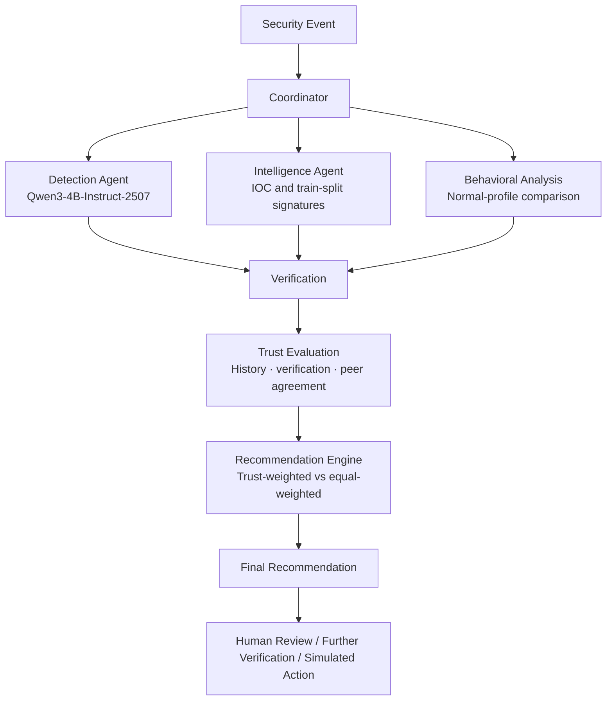

# Fine-Tuned Multi-Agent AI for Cyber Defense

A university semester project by a team of three students exploring a trust-aware, multi-agent AI system for cybersecurity analysis. Specialized agents examine a security event, verify one another's findings, and produce a final recommendation using an interpretable trust mechanism.

This is an academic learning project, not an enterprise cybersecurity platform. **Fine-tuning is planned for Phase 2 and has not started yet.**

## Problem

AI agents can assist with cybersecurity analysis, but their outputs may be incorrect, incomplete, conflicting, or misleading. Treating every agent output as equally reliable can lead to poor decisions when one or more agents are wrong.

## Proposed Solution

Detection, Intelligence, and Behavioral Analysis agents examine a security event. A Verification agent checks findings against the cited evidence. A trust mechanism weighs agent influence using historical accuracy, verification results, and agreement with other agents. The system then recommends a simulated action, further verification, or human review.

## Development Phases

- **Phase 1 — Baseline:** the implemented system establishes the multi-agent pipeline, verification, trust mechanism, evaluation workflow, and Streamlit interface using the base Qwen3-4B-Instruct-2507 model.
- **Phase 2 — Fine-tuned extension (planned):** fine-tune the same base model using a parameter-efficient method such as LoRA/QLoRA, then compare it with the Phase 1 baseline. Per the team's recorded decision (D-010), **only the Detection agent will use the fine-tuned model**.

Phase 2 is intended to extend Phase 1, not rebuild it, so the team can make a more meaningful comparison. See `docs/DECISIONS.md` and `docs/LLM_FINE_TUNING.md`.

## Architecture Overview



Detection uses the base LLM in Phase 1. Intelligence and Behavioral Analysis are rule-based; the agents run independently and communicate through structured findings collected by the Coordinator. The system records recommendations only—**it does not execute actions against live infrastructure**.

For details, see `docs/ARCHITECTURE.md`, `docs/architecture/AGENT_SPECIFICATION.md`, and `docs/architecture/DATA_FLOW.md`.

## Trust-Aware Decision Making

Each agent receives a conceptual trust score informed by historical accuracy, verification results, and agreement with peers—not by the agent's self-reported confidence. Verification is incorporated once in the trust calculation. See `docs/architecture/TRUST_MODEL.md`.

## Evaluation

The team has selected four evaluation metrics:

- **Macro-F1** for the Detection agent's classification performance
- **Schema-valid output rate**
- **Evidence grounding rate**
- **Trust impact rate**, measuring how often trust-weighted voting changes the outcome compared with equal weighting

The pipeline and metric implementations have tests, but **real Qwen3-4B-Instruct-2507 baseline results have not yet been produced**. We will report measured results rather than assume that fine-tuning or trust weighting improves performance. Metric definitions and limitations are documented in `docs/PHASE1_IMPLEMENTATION.md` and `docs/EXPERIMENTS.md`.

## Safety

This is a defensive academic project. The system recommends or simulates actions only; it does not execute actions against live infrastructure. See `docs/THREAT_MODEL.md`.

## Project Status

- **Phase 1:** implementation and end-to-end pipeline tests are in place.
- **Real-model baseline:** results are not yet available.
- **Phase 2 fine-tuning:** not started.
- **Project license:** not yet selected; see decision D-012 in `docs/DECISIONS.md`.

## Repository Structure

```text
src/                     Phase 1 implementation (python -m src.cli ...)
  models/                Pydantic schemas
  agents/                Detection (LLM), Intelligence, Behavioral Analysis, Verification
  trust/                 Trust formula and calibration-based historical accuracy
  recommendation/        Trust-weighted/equal-weighted voting and routing
  coordinator/           Pipeline orchestration
  data/unsw_nb15.py      Dataset preparation and leakage checks
  evaluation/            Metrics, calibration, and evaluation runs
  utils/llm_client.py    OpenAI-compatible client and offline stub
frontend/                Streamlit app and display helpers
tests/                   pytest suite (112 tests)
data/                    Synthetic reference data and evaluation subset IDs
docs/                    Project, architecture, research, testing, and implementation docs
runs/                    Calibration/evaluation outputs (gitignored)
.github/                 GitHub workflow/configuration files
requirements.txt
pyproject.toml
```

Raw dataset files and generated artifacts are not committed. Synthetic reference data is labelled as synthetic.

## Documentation

- [Project scope](docs/PROJECT_SCOPE.md) — goals, phases, and boundaries
- [Architecture](docs/ARCHITECTURE.md) — system design and components
- [System architecture](docs/SYSTEM_ARCHITECTURE.md) — implementation-level architecture
- [Agent specification](docs/architecture/AGENT_SPECIFICATION.md) — each agent's role
- [Agent design](docs/AGENT_DESIGN.md) — implementation patterns and error handling
- [Trust model](docs/architecture/TRUST_MODEL.md) — trust mechanism
- [Data flow](docs/architecture/DATA_FLOW.md) — pipeline flow
- [API reference](docs/API_REFERENCE.md) — internal data models and interfaces
- [Dataset notes](docs/DATASET.md) — data sources and licensing
- [Fine-tuning plan](docs/LLM_FINE_TUNING.md) — Phase 2 methodology
- [Development guide](docs/DEVELOPMENT_GUIDE.md) — setup and workflow
- [Testing](docs/TESTING.md) — testing strategy
- [Experiments](docs/EXPERIMENTS.md) — experiment design and results tracking
- [Decision log](docs/DECISIONS.md) — agreed and pending decisions
- [Research](docs/RESEARCH.md) — background and related work
- [Threat model](docs/THREAT_MODEL.md) — threats and mitigations
- [Phase 1 implementation](docs/PHASE1_IMPLEMENTATION.md) — implemented baseline, metrics, and commands
- [Contributing guide](CONTRIBUTING.md) — contribution and Git workflow
- [Code of conduct](CODE_OF_CONDUCT.md)
- [Security policy](SECURITY.md)
- [Instructions for AI coding agents](AGENTS.md)

## Quick Start

```bash
pip install -r requirements.txt

# Download the official UNSW-NB15 training and testing CSVs, then place them in:
# data/raw/unsw_nb15/
python -m src.cli prepare-data
python -m src.cli validate-data

# Start the local model server (see the implementation guide for Ollama instructions):
vllm serve Qwen/Qwen3-4B-Instruct-2507

python -m src.cli calibrate
python -m src.cli evaluate
streamlit run frontend/app.py
pytest
```

Without a model server, use `--backend stub` for the CLI or set `LLM_BACKEND=stub` for Streamlit to run with a clearly labelled stub Detection model. The stub is useful for testing the pipeline, **not** for reporting real model performance. Full setup instructions: [Phase 1 implementation guide](docs/PHASE1_IMPLEMENTATION.md).

## Team

The project is developed by three students. See [D-008 in the decision log](docs/DECISIONS.md) for the agreed workstream distribution.
